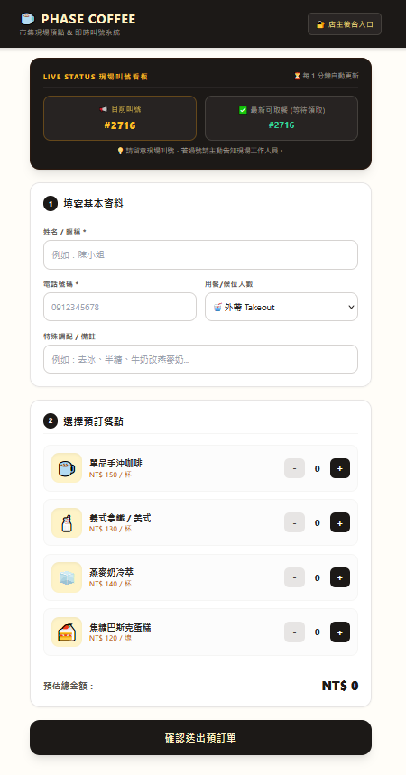
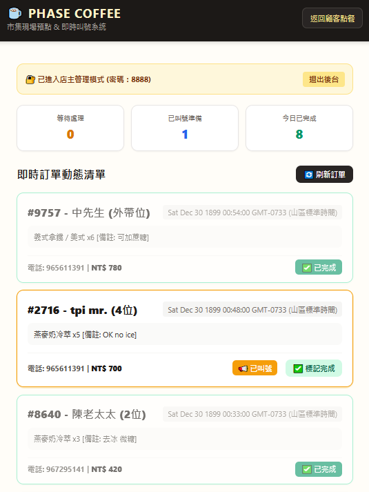
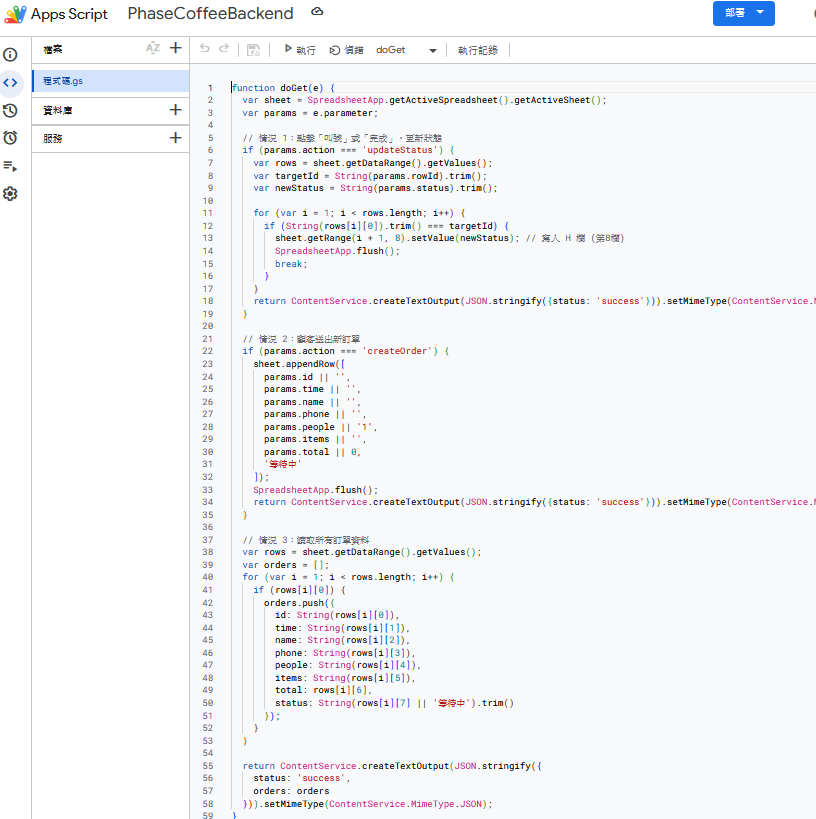

# ☕ Phase Coffee | 市集現場預點與即時叫號系統

> 輕鬆點餐、免排隊久候！為市集咖啡攤量身打造的輕量級即時點餐與候位管理系統。

---

## 📱 系統畫面預覽 (Screenshots)

| 📱 顧客預點 & 即時叫號看板 | 🔐 店主管理後台系統 |
| :---: | :---: |
|  |  |
| *顧客手機掃碼直覺點餐、即時對號* | *管理員一鍵叫號、標記完成與數據統計* |

---

## ✨ 核心優點 (Why Choose Us?)

* 🚀 **極速部署**：前端託管於 GitHub Pages，零伺服器成本。
* ☁️ **Google 試算表即時連動**：以 Google Sheets 作為雲端資料庫，訂單秒速同步。
* 🔄 **雙向自動更新**：顧客端每 60 秒自動背景更新看板，後台每 10 秒即時刷新。
* 📱 **響應式設計 (RWD)**：手機、平板、電腦完美適配，顧客掃描 QR Code 即可點餐。
* 🔐 **安全後台管理**：獨立店主管理介面，透過密碼保護，輕鬆掌控全局。

---

## 🧭 系統操作手冊 (User Guide)

### 👤 顧客點餐與看盤流程
1. **掃描 QR Code** 開啟網頁，查看精美菜單與價格。
2. 填寫**姓名、電話、外帶/人數**，並可自由填寫客製化備註（例：去冰、改燕麥奶）。
3. 勾選想要的咖啡或甜點，系統會**自動計算總金額**。
4. 點擊 **「確認送出預訂單」**，系統將自動產生專屬單號（例：`#8097`）。
5. 隨時透過首頁的 **Live Status 現場叫號看板** 查看進度：
   * 📢 **目前叫號**：顯示正在喊號/通知顧客取餐的單號。
   * ✅ **最新可取餐**：顯示餐點已製作完成、等待客人領取的單號。

---

### 🔐 店主後台管理流程
1. 點擊右上角 **「🔐 店主後台入口」**，輸入管理密碼（預設：`8888`）。
2. **即時數據總覽**：上方卡片隨時掌握「等待處理」、「已叫號準備」與「今日已完成」的累計數量。
3. **訂單狀態三階段管理**：
   * 收到新單後，點擊 **【📢 叫號】** $\rightarrow$ 單號即時推播至前台看板。
   * 餐點備妥、客人到場領取後，點擊 **【✅ 標記完成】** $\rightarrow$ 訂單正式結案，並安全累計至今日總數。
4. 點擊右上角 **「🔄 刷新訂單」** 或等待自動重新整理，隨時同步最新動態。

---

## 🗄️ 雲端後端與資料庫架構 (Backend Architecture)

本系統無縫整合 **Google 試算表** 與 **Google Apps Script (GAS)**，提供穩定且高擴充性的雲端數據庫。

| 📊 雲端試算表資料庫 (Google Sheets) | ⚙️ Apps Script API 後端 (GAS) |
| :---: | :---: |
|  |  |
| *完整記錄單號、時間、姓名、電話、餐點與狀態* | *透過 GET Web App 進行 RESTful API 通訊* |

---

## 🛠️ 技術架構 (Tech Stack)

* **前端介面**：HTML5, Tailwind CSS (Modern UI/UX)
* **後端邏輯**：Google Apps Script (GAS) 
* **資料儲存**：Google 試算表 (Google Sheets Database)
* **版本控制與部署**：GitHub & GitHub Pages

---
